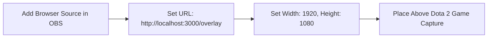
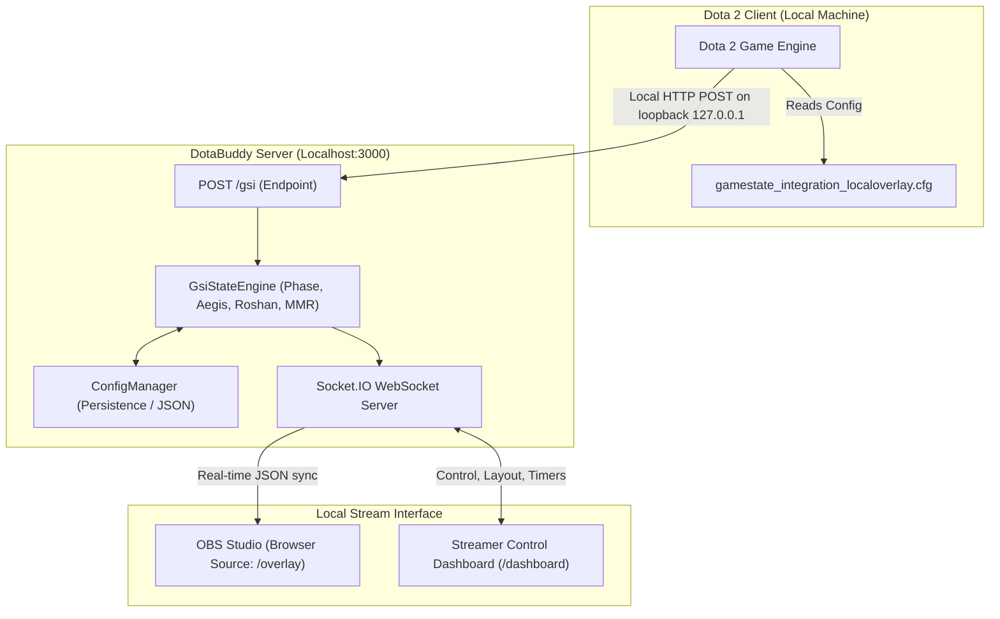

# 🛡️ DotaBuddy — Free, Open-Source & Local-First Dota 2 Stream Suite

<div align="center">

[](https://opensource.org/licenses/MIT)
[](https://nodejs.org/)
[-brightgreen)](https://developer.valvesoftware.com/wiki/Counter-Strike:_Global_Offensive_Game_State_Integration)
[](http://localhost:3000)
[-purple?logo=obs-studio&logoColor=white)](https://obsproject.com/)
[](https://github.com/your-username/DotaBuddy/pulls)

**The complete, privacy-first alternative to Dotabod with all Pro features unlocked — 100% free forever.**

[Features](#-core-features) • [Why DotaBuddy?](#-why-dotabuddy-vs-dotabod) • [Quick Start](#-quick-start-in-3-steps) • [OBS Setup](#-obs-studio-setup) • [Architecture](#-architecture--how-it-works) • [Hotkeys](#-hotkeys--shortcuts) • [Contributing](#-contributing--community) • [Roadmap](#-future-roadmap)

</div>

---

## 💡 What is DotaBuddy?

**DotaBuddy** is a self-hosted, open-source streaming overlay and anti-stream-sniping suite designed specifically for Dota 2 streamers on **Twitch**, **YouTube**, **Kick**, and **Facebook Live**.

Streaming Dota 2 at high ranks or in public matchmaking opens you up to stream snipers who ghost your ward placements, stream-counter your hero drafts, and queue-snipe your matchmaking searches. Existing commercial solutions (like Dotabod) lock these vital protections and tactical timers behind monthly subscriptions, cloud accounts, and proprietary software.

**DotaBuddy changes that:**
- **Zero Subscriptions:** Every single feature is unlocked and free for everyone forever.
- **100% Localhost & Privacy-First:** Your Dota 2 match data never leaves your computer. No external servers, no cloud telemetry, no accounts or registration, and zero trackers.
- **100% VAC-Safe:** Powered strictly by Valve's official, documented **Game State Integration (GSI)** API. No memory hooking, no DLL injection, no process tampering. Completely compliant with Valve's Terms of Service.
- **Streamer-Ready:** Single 1920×1080 OBS Browser Source with real-time WebSocket state synchronization, multi-scene layout editing, hotkeys, and built-in simulation mode.

---

## ⚖️ Why DotaBuddy vs. Dotabod?

| Feature | DotaBuddy (Open Source) | Commercial Overlays (Dotabod Pro) |
| :--- | :---: | :---: |
| **Cost** | **100% Free & Open-Source (MIT)** | \$5 – \$15 / month subscription |
| **Data Privacy** | **Strictly Localhost (`127.0.0.1`)** | Stored on external cloud servers |
| **Account Required** | **None** (Plug & play) | Required login / OAuth tokens |
| **VAC Safety** | **100% Safe (Official Valve GSI)** | Safe (Official Valve GSI) |
| **Main Menu Queue Blocker** | **Included** (Fake Match Banner + Custom Text) | Pro tier only |
| **Hero Pick Blocker** | **Included** (With Smart Hero Reveal) | Pro tier only |
| **Minimap Ward Blocker** | **Included** (Realistic / Complex / Extra-Large) | Pro tier only |
| **Aegis & Roshan Timers** | **Included** (Auto GSI trigger + Radial Ring) | Pro tier only |
| **Live MMR & Rank Medal** | **Included** (Herald to Immortal + SVG Medals) | Limited / Pro tier |
| **Drag & Drop Layout Editor** | **Included** (Multi-scene + Pixel nudge) | Fixed or limited presets |
| **Simulation / Test Mode** | **Included** (Test without launching Dota) | Rare / Unavailable |
| **Community Extensibility** | **Full code access (Fork, PR, mod)** | Closed-source proprietary |

---

## ✨ Core Features

### 1. 🛡️ Anti-Stream-Sniping Shield Suite
Defend your games, MMR, and mental health from stream snipers across every phase of the match.

- **Main Menu Queue Blocker:**
  - Automatically covers the "PLAY DOTA" and "FINDING MATCH" area in the main menu (`DOTA_GAMERULES_STATE_INIT`).
  - Supports a realistic **Fake Match Finding Banner** with customizable queue text (e.g. `Ranked match / All pick / SE Asia`) to disguise your actual queue timing.
  - Automatically unmasks once a match is found and loading begins.
- **Hero Pick Blocker (Draft Phase):**
  - Shields all 10 Radiant and Dire pick slots, the draft minimap preview, and the "CHOOSE YOUR HERO" area during hero selection (`DOTA_GAMERULES_STATE_HERO_SELECTION` & `WAIT_FOR_PLAYERS_TO_LOAD`).
  - **Smart Reveal Logic:** Keeps enemy and ally hero cards hidden while intelligently revealing only your own locked-in hero card!
  - Automatically dissolves the moment Strategy Phase (`DOTA_GAMERULES_STATE_STRATEGY_TIME`) begins.
- **Minimap Ward Blocker (In-Game):**
  - Masks ward eye positions and cliffs during pre-game and active matches without blocking critical lane movement.
  - Choose between **Realistic Map Overlay** (`map_overlay.png`), **Complex Textured SVG Terrain**, or **Simple SVG Minimap**.
  - Full support for **Extra Large Minimap** (280px), **Right-Side Minimap**, **Custom HUD Offsets**, and adjustable blocker opacity (0% to 100%).

---

### 2. ⏱️ Real-Time Tactical Timers
Automated, unobtrusive HUD timers synchronized directly with game events.

- **Aegis of the Immortal (5:00 Countdown):**
  - Renders directly below the carrier's hero portrait on the top 5v5 HUD bar (or any custom position).
  - Automatically activates when an Aegis is picked up in GSI inventory, or manually via hotkey (`Alt+A`).
  - Sleek translucent Aegis shield icon with golden borders and high-visibility countdown.
- **Roshan Respawn Radial HUD Ring (11:00 Timer):**
  - Positioned seamlessly next to the minimap scan/glyph widget (dynamically repositioned for extra-large and right-side minimaps).
  - **Two-Stage Visual Alert:**
    - 🔴 **Red Ring (11:00 down to 3:00):** Guaranteed dead window (8 minutes).
    - 🟡 **Yellow Ring (3:00 down to 0:00):** Warning window for the 3-minute random respawn period.
  - Automatically starts upon Roshan death or Aegis pickup, with manual hotkey override (`Alt+R` / `Alt+Y`).

---

### 3. 🏆 Stream MMR & Win/Loss Tracker
Professional broadcast stats that match Dota 2's native UI aesthetics.

- **Automated Win/Loss Detection:** Tracks match outcomes via GSI (`map.win_team` vs `player.team_name`) with built-in match ID deduplication to prevent duplicate triggers.
- **MMR Adjustment:** Configurable MMR delta (`+/- 25` default or custom step) with manual one-click override buttons (`+1 Win`, `+1 Loss`, `Reset Session`).
- **Dynamic Rank Medal System:** Automatically maps your current MMR to the official Dota 2 ranking system (Herald I through Immortal with Star tiers and Leaderboard numbers) with high-res SVG medals and PNG support.
- **Flexible Screen Placement:** Toggle between **Top Menu Bar** (`STREAM | 1W - 0L | 7,455 MMR`) or **Bottom HUD** (integrated cleanly to the left of the gold indicator).

---

### 4. 🎨 Visual Drag-and-Drop Multi-Scene Layout Editor
Customize your stream overlay without ever touching code.

- **WYSIWYG Scene Canvas:** Interactive live editor featuring high-resolution reference HUD backdrops (`sample_dota_scene.png`).
- **Multi-Scene Layouts:** Customize widget placements independently across four scenes:
  - `main_menu`
  - `drafting_phase`
  - `draft_own_hero_locked`
  - `in_game`
- **Pixel-Perfect Controls:** Drag with mouse, nudge 1px with keyboard arrow keys, or nudge 10px with `Shift + Arrow`.
- **1-Click Auto-Align Aegis:** Perfectly balances and aligns all 10 Aegis slot timers across hero portraits with a single click.

---

### 5. 🧪 Built-in Simulation Mode & Diagnostics
Test your stream setup anytime — no live game required!

- Simulated triggers for **Main Menu**, **Connecting**, **Draft Phase**, **Hero Locked**, **Strategy Time**, and **In-Game**.
- One-click timer tests for **Aegis 5:00**, **Roshan 11:00 Red**, and **Roshan 3:00 Yellow**.
- Win/Loss outcome simulations (+MMR / -MMR) to verify browser source animations on stream before going live.

---

## 🚀 Quick Start in 3 Steps

### Prerequisites
- [Node.js](https://nodejs.org/) v18.0.0 or higher
- [Dota 2](https://store.steampowered.com/app/570/Dota_2/) (Installed via Steam on Windows, Linux, or macOS)
- [OBS Studio](https://obsproject.com/) (or Streamlabs Desktop)

---

### Step 1: Install DotaBuddy

Clone the repository and install dependencies:

```bash
# Clone the repository
git clone https://github.com/your-username/DotaBuddy.git

# Navigate into the project folder
cd DotaBuddy

# Install dependencies (Express + Socket.IO)
npm install
```

---

### Step 2: 1-Click Dota 2 GSI Setup

DotaBuddy needs a small configuration file inside your Dota 2 directory so the game can broadcast game events to your local server.

Run the automated installer:

```bash
npm run setup-gsi
```

*Alternatively, Windows PowerShell users can run:*
```powershell
.\setup-gsi.ps1
```

> [!TIP]
> **Steam Launch Options:**
> To ensure Dota 2 broadcasts Game State Integration, add `-gamestateintegration` to your Dota 2 Launch Options:
> 1. Open **Steam** → Right-click **Dota 2** → **Properties...**
> 2. In the **General** tab under **Launch Options**, add:
>    ```text
>    -gamestateintegration
>    ```

---

### Step 3: Launch DotaBuddy

Start the local server:

```bash
npm start
```

Once running, access your tools in your browser:
- 🎛️ **Streamer Control Dashboard:** [http://localhost:3000/dashboard](http://localhost:3000/dashboard)
- 📺 **OBS Browser Source Overlay:** [http://localhost:3000/overlay](http://localhost:3000/overlay)

---

## 🎥 OBS Studio Setup

Setting up DotaBuddy in OBS Studio takes less than 30 seconds:



1. In OBS Studio, navigate to your **Sources** dock and click **`+`** → **Browser**.
2. Name the source (e.g. `DotaBuddy Overlay`).
3. Set the following properties:
   - **URL:** `http://localhost:3000/overlay`
   - **Width:** `1920`
   - **Height:** `1080`
   - **Custom CSS:** *(Leave empty)*
   - **Shutdown source when not visible:** `Unchecked` *(Ensures timers continue running smoothly)*
   - **Refresh browser when scene becomes active:** `Unchecked`
4. Click **OK**.
5. Position `DotaBuddy Overlay` directly above your **Game Capture (Dota 2)** source.

---

## ⌨️ Hotkeys & Shortcuts

Control timers on the fly while streaming directly from the dashboard:

| Shortcut | Action | Description |
| :--- | :--- | :--- |
| <kbd>Alt</kbd> + <kbd>A</kbd> | **Start Aegis Timer** | Triggers 5:00 countdown for selected hero slot |
| <kbd>Alt</kbd> + <kbd>R</kbd> | **Start Roshan Timer** | Triggers 11:00 Roshan respawn countdown (Red window) |
| <kbd>Alt</kbd> + <kbd>Y</kbd> | **Roshan 3:00 Window** | Fast-forwards Roshan timer to the 3:00 yellow window |
| <kbd>Arrow Keys</kbd> | **Nudge Widget 1px** | Move selected widget by 1 pixel in Layout Editor |
| <kbd>Shift</kbd> + <kbd>Arrows</kbd> | **Nudge Widget 10px** | Move selected widget by 10 pixels in Layout Editor |

---

## 🏗️ Architecture & How It Works

DotaBuddy is built to be ultra-fast, lightweight, and completely self-contained. It operates with virtually zero CPU overhead and minimal memory usage.



### Privacy & Anti-Cheat Guarantee
1. **Localhost Only:** Communication happens entirely over the local loopback interface (`127.0.0.1`). No network packets are transmitted over the public internet.
2. **Official Valve Integration:** Dota 2 natively supports Game State Integration, originally engineered by Valve for CS:GO and Dota 2 tournament organizers and broadcast talent. It does not read memory or modify executable code.

---

## 🧪 Testing & Quality Assurance

DotaBuddy comes with an exhaustive test suite verifying state handling, GSI parsing, timer transitions, layout coordinates, and crash recovery:

```bash
# Run unit and integration tests
npm test
```

```text
✔ ConfigManager persists settings, clamps values, and tracks MMR/W-L across restarts
✔ GsiStateEngine detects Main Menu, Draft Phase (with Smart Reveal), and In-Game states
✔ GsiStateEngine handles Aegis 5:00 countdown and Roshan 11:00 Red -> 3:00 Yellow respawn transition
✔ GsiStateEngine auto-detects match win/loss via GSI with matchId deduplication
✔ GSI Config Installer generates gamestate_integration_localoverlay.cfg in Dota 2 cfg directory
✔ HTTP Server & REST Endpoints serve /dashboard, /overlay, /gsi, and /api/simulate
✔ Overlay Frontend Script accurately updates DOM coordinates, visibility, and classes across all 5 features
✔ Multi-Scene Layout Editor: independent scenes, 10 Aegis slot timers, drafting masks, auto-align

ℹ 20 passing tests (0 failures)
```

---

## 🗺️ Future Roadmap

We are actively developing DotaBuddy with the community. Here are some of the features planned:

- [ ] **Sound Alerts & Audio Cues:** Optional subtle sound effects when Roshan enters the 3:00 yellow window or when Aegis expires.
- [ ] **Twitch & Kick Chat Bot:** Stream chat commands like `!mmr`, `!rank`, `!roshan`, and `!stats` responding directly from local state.
- [ ] **Neutral Item Tier Timers:** Visual reminders when Tier 1 (7:00), Tier 2 (17:00), Tier 3 (27:00), Tier 4 (37:00), and Tier 5 (60:00) neutral tokens become available.
- [ ] **Webcam Frame & Cutout Presets:** Pre-styled webcam masks matching Dota 2 HUD themes (radiant / dire / minimalist).
- [ ] **Packaged Desktop App (.exe):** Single-click executable with system tray controls for streamers who prefer not to run terminal commands.
- [ ] **Internationalization (i18n):** Dashboard localization for Russian, Chinese, Spanish, Portuguese, and Tagalog.

---

## 🤝 Contributing & Community

**DotaBuddy is free and open-source software.** We built this project to give the Dota 2 streaming community a high-quality, privacy-respecting alternative to expensive commercial tools.

We welcome contributions of all shapes and sizes!

### How You Can Help
- 🌟 **Star the Repository:** Help streamers and developers discover the project!
- 🐛 **Report Bugs:** Find an issue or a bug in a specific game mode (Turbo, Captains Mode, Ability Draft)? [Open an Issue](https://github.com/your-username/DotaBuddy/issues).
- 💡 **Suggest Features:** Have an idea that would make your stream look even better? Submit a feature request!
- 🛠️ **Submit Pull Requests:** Check out open issues, add new HUD themes, improve the layout editor, or optimize performance.
- 🎙️ **Streamers & Content Creators:** Use DotaBuddy on your stream and tell your fellow Dota streamers! Share your overlay clips and feedback with us.

### Development Workflow
1. Fork the repo and create your branch: `git checkout -b feature/amazing-feature`
2. Make your improvements and test thoroughly: `npm test`
3. Commit your changes with clear messages: `git commit -m 'Add: audio alerts for roshan timer'`
4. Push to your branch: `git push origin feature/amazing-feature`
5. Open a Pull Request!

---

## 📄 License

This project is licensed under the **MIT License** — see the [LICENSE](LICENSE) file for details. You are free to use, modify, distribute, and stream with this software without restriction.

---

## 🙏 Acknowledgments & Disclaimer

- **Valve Corporation:** Dota 2 and the Dota 2 logo are trademarks and/or registered trademarks of Valve Corporation. DotaBuddy is not affiliated with or endorsed by Valve Corporation.
- **Dota 2 Streaming Community:** Inspired by the countless streamers on Twitch, YouTube, and Kick who keep the Dota community thriving.
- Built with ❤️ for the global Dota 2 community.

<div align="center">

**Enjoying DotaBuddy? Don't forget to star ⭐ this repository and share it with your favorite Dota 2 streamers!**

</div>
